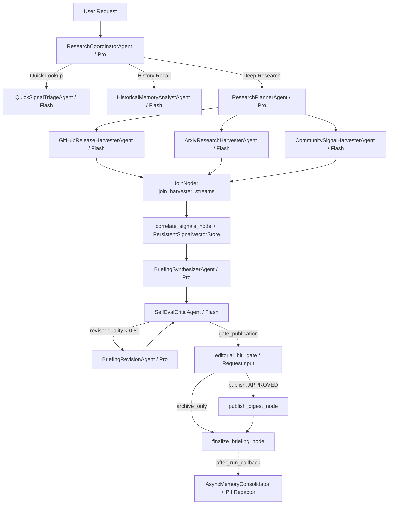

# Agent Harness & Workflow Automation Signal Radar

An enterprise-grade **Deep Research Multi-Agent System** built with **Google Agent Development Kit (`google-adk>=2.15.0`)** that discovers, correlates, verifies, and consolidates engineering signals on **AI Agent Harnesses** and **Workflow Automation** across GitHub releases, arXiv preprints, practitioner engineering forums, and persistent historical briefings.

---

## Problem & Solution

### Problem
Keeping pace with AI agent engineering requires tracking fast-moving changes across two tightly coupled disciplines:
1. **Agent Harnesses**: strict tool JSON schemas, guided recovery payloads, MCP tool sandboxing, A2A interoperability, history compaction, context caching, and deterministic CI evaluations.
2. **Workflow Automation**: declarative DAG / graph orchestration, durable checkpointing, saga retries, strategic model routing, policy plugins, and Human-in-the-Loop (HITL) execution gates.

Manual monitoring across release feeds, preprints, and engineering threads is fragmented, slow, and prone to noisy summaries without verifiable provenance.

### Solution
`harness_signal_radar` implements a production **Coordinator + Graph Workflow** architecture in Google ADK:
- **Coordinator & Sub-Agent Delegation**: `ResearchCoordinatorAgent` (`gemini-2.5-pro`) routes lightweight lookups to `QuickSignalTriageAgent` (`gemini-2.5-flash`), archive comparisons to `HistoricalMemoryAnalystAgent`, and full research briefs to `deep_research_consolidation_workflow`.
- **Hybrid Sequential + Parallel Fan-Out / Join Workflow**:
  1. `prepare_research_context` -> normalizes parameters into session state.
  2. `research_planner_agent` (`gemini-2.5-pro`) -> emits strict `ResearchPlanSchema`.
  3. **Concurrent Fan-Out**: `github_harvester_agent`, `arxiv_harvester_agent`, and `community_harvester_agent` (`gemini-2.5-flash`) execute simultaneously and converge at `JoinNode` (`join_harvester_streams`).
  4. `correlate_signals_node` -> deduplicates, scores authority/velocity, queries persistent SQLite vector briefings, and clusters cross-source convergence themes.
  5. `briefing_synthesizer_agent` (`gemini-2.5-pro`) -> generates `ConsolidatedResearchBrief`.
  6. **Self-Evaluation Revision Loop**: `self_eval_critic_agent` (`gemini-2.5-flash`) audits citation grounding and hallucination risk, triggering `briefing_revision_agent` when quality gates fail.
  7. **Human-in-the-Loop (HITL) Gate**: `editorial_hitl_gate` pauses with ADK `RequestInput` before any external publication (`publish_approved_executive_signal_digest`), enforced independently by `SecurityAndPolicyGuardrailPlugin`.



---

## AgentOps Code Review Matrix (19/19 Criteria)

| Category | Criterion | Implementation Evidence |
|---|---|---|
| **1. Tool & Interface Design** | Comprehensive Tool Docstrings | Every tool in [`harness_signal_radar/tools/`](harness_signal_radar/tools/) documents purpose, args, return contract, and recovery behavior; enforced in [`StrictSchemaFunctionTool`](harness_signal_radar/tools/strict_tool.py). |
| | Descriptive Naming | Specific verbs & domains: `fetch_github_agent_framework_releases`, `search_arxiv_agent_orchestration_papers`, `scan_hackernews_workflow_automation_signals`, `correlate_and_score_research_signals`, `retrieve_archived_signal_briefings`, `request_human_editorial_publication_approval`, `publish_approved_executive_signal_digest`. |
| | Explicit JSON Schemas | [`schemas.py`](harness_signal_radar/schemas.py) (`extra="forbid"`) + [`StrictSchemaFunctionTool._get_declaration`](harness_signal_radar/tools/strict_tool.py) emits both `parameters_json_schema` and `response_json_schema`. |
| | Guided Error Handling | Validation and runtime failures return `GuidedRecoveryAdvice` (`error_code`, `recovery_instructions`, `suggested_parameters`, `retryable`) rather than crashing. |
| **2. Context & Memory** | Robust System Instructions | `<CONSTITUTION>` persona, evidence hierarchy, anti-hallucination, security, and HITL governance in [`prompts/constitution.py`](harness_signal_radar/prompts/constitution.py). |
| | History Compaction | `EventsCompactionConfig` + [`SignalAwareEventsSummarizer`](harness_signal_radar/memory/compaction.py), `ContextCacheConfig`, `ContextFilterPlugin`, and [`TokenBudgetCompactionPlugin`](harness_signal_radar/memory/compaction.py). |
| | Persistent Session State | [`create_persistent_session_service`](harness_signal_radar/memory/persistence.py) (`DatabaseSessionService` / `VertexAiSessionService`) + [`PersistentSignalVectorStore`](harness_signal_radar/memory/persistence.py) + `SqliteMemoryService`. |
| | Async Memory Operations | [`AsyncMemoryConsolidator`](harness_signal_radar/memory/async_consolidator.py) + [`AsyncMemoryLifecyclePlugin`](harness_signal_radar/memory/async_consolidator.py) schedule background `asyncio.Task` indexing without blocking UI turns. |
| **3. Orchestration & Logic** | Multi-Agent Patterns | Coordinator + specialized sub-agents in [`agent.py`](harness_signal_radar/agent.py) and graph `Workflow` (sequential, parallel fan-out, `JoinNode`, self-eval cycle) in [`workflows/deep_research_workflow.py`](harness_signal_radar/workflows/deep_research_workflow.py). |
| | Strategic Model Routing | [`StrategicModelRouter`](harness_signal_radar/routing/model_router.py) & [`DynamicModelRoutingPlugin`](harness_signal_radar/routing/model_router.py) split `gemini-2.5-pro` (planning/synthesis) vs `gemini-2.5-flash` (harvesters/critic/triage). |
| | Guardrails & Policy Plugins | [`SecurityAndPolicyGuardrailPlugin`](harness_signal_radar/guardrails/policy_plugin.py) blocks prompt injection, SSRF, unapproved publishing, and optional Cloud Model Armor threats; `SelfEvalCriticAgent` provides self-eval gating. |
| | Human-in-the-Loop Hooks | Resumable `RequestInput` gate in [`guardrails/hitl.py`](harness_signal_radar/guardrails/hitl.py) and `LongRunningFunctionTool` (`request_human_editorial_publication_approval`) in [`tools/memory_and_publishing.py`](harness_signal_radar/tools/memory_and_publishing.py). |
| **4. Observability & Tracing** | Structured JSON Logging | `structlog` JSON renderer with trace correlation in [`observability/logging_config.py`](harness_signal_radar/observability/logging_config.py); zero `print()` statements in package code. |
| | Intent vs. Outcome Capture | [`IntentOutcomeAuditPlugin`](harness_signal_radar/observability/intent_outcome.py) logs linked `INTENT` (pre-execution) and `OUTCOME` (post-execution) records for runs, agents, LLM calls, and tools. |
| | Distributed Tracing | OpenTelemetry `TracerProvider`, `AutoTracingPlugin`, and linked spans in [`observability/tracing.py`](harness_signal_radar/observability/tracing.py). |
| | PII Redaction | [`SensitiveDataRedactor`](harness_signal_radar/observability/pii_redactor.py) scrubs emails, phones, SSNs, cards, tokens, and internal IPs (plus optional Cloud DLP) before logging and memory persistence. |
| **5. Infrastructure & CI/CD** | Automated Evaluation Suites | [`eval/golden_dataset.json`](eval/golden_dataset.json) + [`eval/run_evaluation.py`](eval/run_evaluation.py) + [`eval/test_config.json`](eval/test_config.json) + GitHub Actions CI ([`.github/workflows/ci.yml`](.github/workflows/ci.yml)). |
| | Infrastructure as Code | Modular Terraform in [`infra/terraform/`](infra/terraform/) provisioning Cloud Run, Secret Manager, GCS artifacts, IAM, Cloud Logging metrics, plus [`Dockerfile`](Dockerfile) and ADK CLI workflows. |
| | Secure Secret Management | [`SecretManagerResolver`](harness_signal_radar/config/secrets.py) backed by Google Cloud Secret Manager (`access_secret_version`) with zero hardcoded keys. |

---

## Quickstart & Local Development

### 1. Environment Setup
```bash
git clone https://github.com/turanbulmus/agent-harness-signal-radar.git
cd agent-harness-signal-radar

uv venv --python python3.12 .venv
source .venv/bin/activate
uv pip install -e ".[dev]"

cp .env.example .env
# Populate GOOGLE_API_KEY (for live Gemini calls) or configure Vertex AI ADC.
```

### 2. Run Simulated End-to-End Deep Research Demo (No API Key Required)
```bash
python scripts/demo_cli.py --simulate
```

### 3. ADK Developer & Agent CLI Workflows
```bash
# Interactive terminal session via ADK CLI
adk run harness_signal_radar

# Local ADK Web UI (http://localhost:8000)
adk web .

# Production-style HTTP API Server
adk api_server --host 0.0.0.0 --port 8080 .

# Evaluate against ADK eval set configuration (with live credentials)
adk eval harness_signal_radar eval/golden_dataset.json --config_file_path eval/test_config.json
```

### 4. Testing, Linting & Regression Evaluation
```bash
# Lint & static checks
ruff check .

# Full unit & integration test suite
pytest -v

# Deterministic golden dataset regression gate (threshold >= 0.95)
python eval/run_evaluation.py --min-score 0.95
```

---

## Cloud Deployment (Terraform + Agent CLI)

### Provision Infrastructure with Terraform
```bash
cd infra/terraform
cp terraform.tfvars.example terraform.tfvars
# Edit terraform.tfvars with your GCP project_id and container_image

terraform init
terraform plan
terraform apply
```

Populate the created Secret Manager shells out-of-band without committing credentials:
```bash
printf '%s' "$YOUR_GITHUB_TOKEN" | gcloud secrets versions add github-pat-token --data-file=-
printf '%s' "$YOUR_GEMINI_KEY" | gcloud secrets versions add gemini-api-key --data-file=-
```

### Deploy via ADK CLI / Vertex AI Agent Engine
```bash
# Option A: Deploy directly to Vertex AI Agent Engine via ADK CLI
adk deploy agent_engine \
  --project="$GOOGLE_CLOUD_PROJECT" \
  --region="$GOOGLE_CLOUD_LOCATION" \
  --display_name="harness-signal-radar" \
  harness_signal_radar

# Option B: Deploy container to Cloud Run via ADK CLI
adk deploy cloud_run \
  --project="$GOOGLE_CLOUD_PROJECT" \
  --region="$GOOGLE_CLOUD_LOCATION" \
  --service_name="harness-signal-radar" \
  harness_signal_radar

# Option C: Scaffold starter cloud pipelines with Agent Starter Pack
uvx agent-starter-pack enhance . --adk
```

---

## License
Apache License 2.0 — see [LICENSE](LICENSE).
